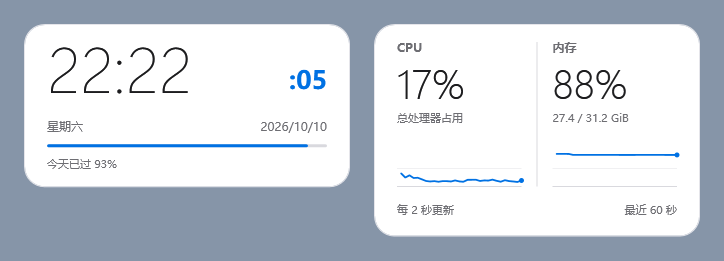
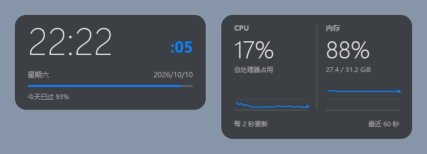

# WitchDrawer 插件开发与投稿

插件 API v1 使用原生 WPF，面向维护者审核过的可信桌面组件。当前每个插件支持一个桌面实例，与文件盒独立管理。桌面时钟 v1.0.0 已发布并收录，可在支持插件的开发版中刷新目录安装，也可本地打包试用。

投稿与线上目录统一放在独立的 [WitchDrawer.Plugins 仓库](https://github.com/witchscottishfoldcat/WitchDrawer.Plugins)。本体仓库中的目录是离线回退和开发示例；插件目录 PR 请提交到插件仓库。以下投稿命令在插件仓库根目录运行。

## 作者提交 PR

1. 使用 `samples/Clock` 作为模板，在自己的公开 GitHub 仓库保存源码及构建步骤。
2. 发布固定版本的 Release ZIP，使用 `Get-FileHash -Algorithm SHA256` 计算校验值。包根目录包含 `plugin.json`、入口 DLL、`.deps.json` 和所需依赖；不要附带 .NET/WPF 运行时或 `WitchDrawer.PluginSdk.dll`。
3. 复制 `templates/catalog-entry.json` 到 `entries/{插件ID}.json`，填写资料。`plugin` 字段须与包根目录的 `plugin.json` 完整一致，可省略空的 `maxHostVersion` 和 `screenshotUrl`。
4. 在仓库根目录运行：

   ```powershell
   dotnet run --project tools/PluginCatalog -- --write
   dotnet run --project tools/PluginCatalog -- --check
   ```

5. 向 [WitchDrawer.Plugins](https://github.com/witchscottishfoldcat/WitchDrawer.Plugins/compare) 提交 PR，包含条目与生成后的 `catalog.json`。填写仓库默认 PR 模板，附截图、源码 tag/commit、构建方法、依赖许可证和启动、内存、后台 CPU 开销。
6. 维护者审核合并后，用户刷新插件中心即可看到该版本。

不熟悉 PR 的作者可在应用内点击「提交插件」填写 GitHub Issue 表单，维护者审核后代为加入目录。投稿需要 GitHub 账号，安装公开插件无需登录。

## 插件接口

引用 `src/WitchDrawer.PluginSdk/WitchDrawer.PluginSdk.csproj`，外部仓库也可引用从该项目构建的 SDK DLL。项目使用 `net10.0-windows`、`UseWPF=true`、`EnableDynamicLoading=true`；SDK 的 ProjectReference 设置 `Private=false`、`ExcludeAssets=runtime`，SDK 不进入插件包。

实现公共 `IWidgetPlugin` 类型和无参构造函数。`CreateView(WidgetContext)` 返回 WPF 控件；可实现 `CreateSettingsView()` 返回设置控件。`context.SaveSettingsAsync()` 保存少量配置，`context.ReportError()` 报告运行错误，`context.Culture` 跟随本体语言。宿主提供窗口、主题资源、拖动、位置与大小记忆和关闭即停用行为。

- 构造函数、视图工厂和 `Dispose()` 在 UI 线程执行，必须快速返回。扫描、采集、文件 I/O 和计算放到后台，通过 Dispatcher 更新结果。
- 停用必须停止计时器、取消任务、解绑事件并释放资源；未启用的插件不会加载 DLL 或启动组件计时器。
- 用户文件的移动、删除、重命名必须通过本体 Core 服务。本版 SDK 未开放这类接口，请不要自行操作收纳盒文件。
- 宿主外壳跟随桌面收纳盒的主题、背景色、透明度、边框和圆角；背景透明度不会降低插件文字的不透明度。插件内容使用 `SetResourceReference` 或 `DynamicResource` 绑定 `TextPrimaryBrush`、`TextMutedBrush`、`AccentBrush` 等主题键，即可随主题实时更新。避免把这些画刷读取一次后固定到控件上。
- `permissions` 可声明 `network`、`system-metrics`、`files`。这些是行为说明，不能限制 DLL 的实际访问。插件与本体共享进程权限，运行错误需捕获并报告，本版不提供任意第三方代码的沙箱隔离。
- UI 帧工作以 8.33 ms 为预算。时钟每秒刷新，性能组件建议每 1～2 秒后台采样；新增依赖须说明启动、内存、后台 CPU 成本。

## 打包并试用时钟

```powershell
.\tools\Pack-Plugin.ps1
```

输出在 `publish/plugins/`，包含独立 ZIP 和 SHA-256 文件。打开 WitchDrawer → 插件 → 安装本地插件 → 选择 ZIP → 查看信任提示 → 启用。时钟设置中可切换秒数、12/24 小时制，以及星期和日期的显示；拖动组件空白处移动，拖动边缘或四角缩放。内容按比例缩放并靠上对齐，松手后通过 Core 保存位置与大小，重启和插件更新后恢复；取消缩放会回到拖拽前的布局。悬停时右上角显示关闭按钮，右下角显示小缩放标记；关闭按钮以浮层显示，不占用内容高度，点击即停用。示例不会随本体打包自动安装，脚本不会上传到 GitHub。

外部作者可使用 `Pack-Plugin.ps1 -Project C:\path\Plugin.csproj -OutputDirectory C:\path\output`。脚本保留完整 publish 临时目录供检查，并拒绝覆盖同名 ZIP。

## 本地新版组件

开发源码包含桌面时钟 v1.1.1 和性能监控 v1.0.0。新版时钟以时间为首行，星期和日期在下方小字显示，附当日进度；可隐藏日期，保留秒数与 12/24 小时制设置。性能组件显示总 CPU 占用、已用/总物理内存以及最近 60 秒的两条趋势，每 2 秒后台采样。





```powershell
.\tools\Pack-Plugin.ps1 -Project plugins\samples\Performance\WitchDrawer.Performance.csproj
```

两个包仍是可选插件，源码更新不会改变已发布目录。新版本要发布固定 Release ZIP 并审核收录后，才会出现在在线目录中。

性能组件没有新增第三方运行时依赖：CPU 使用 Windows PDH 的 `Processor Information(_Total)` 计数器（英语路径与系统语言无关，包含处理器组），内存使用 `GlobalMemoryStatusEx`。原生采集实现在 `src/WitchDrawer.Native/Metrics`，通过源文件链接编译到独立插件 DLL；插件包不引用或携带宿主 Core/Native 程序集。宿主没有后台采样任务，启用时才在工作线程打开查询，首个有效间隔前 CPU 显示等待状态；如果系统禁用了 CPU 计数器，只显示 CPU 数据不可用，内存仍可使用。

每条曲线最多保存 31 个数值，使用单个 WPF 绘图控件，不创建逐点控件或逐帧动画。后台每次等待 UI 接收后再采样，最多排队一次更新；停用即取消采样并在后台释放 PDH 查询。界面采用动态主题画刷，跟随颜色和背景透明度。数字在 0～100% 范围显示；内存使用 GiB（1024³ 字节）。

参考：[PdhAddEnglishCounterW](https://learn.microsoft.com/en-us/windows/win32/api/pdh/nf-pdh-pdhaddenglishcounterw)、[PdhGetFormattedCounterValue](https://learn.microsoft.com/en-us/windows/win32/api/pdh/nf-pdh-pdhgetformattedcountervalue)、[GlobalMemoryStatusEx](https://learn.microsoft.com/en-us/windows/win32/api/sysinfoapi/nf-sysinfoapi-globalmemorystatusex)。

## 更新与审核

每次更新需要新的固定 Release URL、版本和 SHA-256，经 PR 审核后收录。禁止 `latest` 地址或自动跟随作者最新 Release。插件停用后才能更新，更新保留配置和位置，更新后保持停用。坏包、取消下载或安装失败不会切换已安装版本；旧 DLL 锁定时，旧包在重启后的插件管理访问中清理。

自动检查只验证元数据与目录一致性，不下载或执行投稿插件。维护者需核对作者身份（更新来自原作者或获授权的维护者）、源码与包一致性、访问行为、资源成本、依赖许可和实际效果。可在分支保护中把 `Plugin catalog / validate` 设为必需检查并要求维护者审批。

配置、目录缓存和安装包保存在当前数据目录的 `Plugins/` 下。断网可运行已启用插件。安装检查包括路径越界、链接、重复路径、包大小、入口和共享 SDK；载入前核对已安装文件。V1 暂不提供多实例、沙箱、付费交易或自动更新插件。

## 目录上线

合并到 `WitchDrawer.Plugins` 的 `main` 后，应用读取该仓库固定的 `plugins/catalog.json`。空目录不会展示尚未发布的示例包。远端发布需维护者单独完成：发布固定版本的插件包，填入实际校验值后生成目录并合并，不能填占位值或不存在的安装包。

本版新增的运行时程序集仅有小型 PluginSdk 合约，无第三方新依赖。SDK 随本体装载，未启用插件时没有组件计时器、原生监控钩子或网络请求；目录页首次打开才联网，程序集校验与加载在后台完成。
